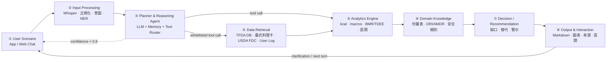

# DESIGN.md — DietSense

> A Data-Grounded and Safety-Aware Conversational AI Agent for Personalized Dietary Assessment and Weight Management
> 狀態：Proposal 階段（所有數字均為 Expected Outcomes）｜工作流程：已轉為 OpenSpec → [`openspec/changes/build-dietsense-agent/`](openspec/changes/build-dietsense-agent/)

依期末規範，DESIGN.md 依序回答：Problem → Requirements → Architecture → Components → Data → AI/Analytics → Domain Knowledge → Algorithm → Implementation → How to Run → Results。

---

## 1. Problem

傳統飲食記錄需「搜尋 → 選品牌 → 秤重 → 拆解複合菜」，認知負擔高、遵循率隨時間下降；自報低報 18–54%；
通用 LLM 直接回答熱量會虛構數值（影像估算 MAPE ≈ 36%）。臺灣外食、夜市與湯麵類料理在西方資料庫覆蓋不足。
詳見 [docs/04-introduction.md](docs/04-introduction.md)。

## 2. Requirements（摘要；正式版見 OpenSpec specs）

| ID | 需求 | Capability |
|---|---|---|
| R1 | 接受繁中自然語言（文字/語音）描述飲食，抽取食物、份量、烹調、餐別 | `input-understanding` |
| R2 | LLM 只能經白名單工具取得數值；回應中任何 kcal/營養素數字必須來自工具輸出 | `agent-orchestration` |
| R3 | 多來源營養查詢（臺灣 DB 優先 → 臺式料理卡 → USDA FDC），每筆附來源 | `nutrition-retrieval` |
| R4 | 確定性計算熱量、巨量營養素、BMR/TDEE | `energy-analytics` |
| R5 | 信心 < 0.80 時主動追問（≤ 2 輪），輸出區間而非假精確 | `uncertainty-clarification` |
| R6 | < 1,200 kcal/日、極端節食、飲食失調、高風險族群 → 警示/轉介 | `safety-guardrails` |
| R7 | 每日摘要、TDEE 缺口、替代建議、圖表與來源揭露 | `recommendation-output` |
| R8 | 500 筆臺式料理標註集與可重現評估腳本 | `evaluation-benchmark` |

## 3. Architecture（八模組 ①–⑧）



**核心原則**：LLM orchestrates, deterministic tools compute, rules decide safety.

## 4. Components

| # | 模組 | 主要元件 | 介面 |
|---|---|---|---|
| ① | User Scenario | Web chat（MVP：Streamlit/Next.js）、使用者檔案 | `POST /chat` |
| ② | Input Processing | Whisper（選用）、OpenCC 繁簡、意圖分類 `log_food / query_nutrition / analyze / recommend / other`、LLM 結構化抽取（JSON schema） | `parse(text) → ParsedMeal` |
| ③ | Planner | LLM（function calling）、對話記憶、工具白名單、Response Guard | `plan(state) → ToolCall[]` |
| ④ | Retrieval | `lookup_food(name, context)`：臺灣食品成分資料庫 → 臺式料理卡（向量檢索）→ USDA FDC API | `FoodCandidate{kcal_100g, macros, source, confidence}` |
| ⑤ | Analytics | `compute_energy`、`compute_macros`、`bmr_mifflin`、`tdee`、`interval` | 純函式、100% 單元測試 |
| ⑥ | Domain Knowledge | 臺灣常見容器份量表（碗/便當/杯）、AMDR、國民飲食指南、安全規則 YAML | `rules.evaluate(day, profile)` |
| ⑦ | Decision | 每日缺口、替代建議（規則 + 檢索）、警示等級 `OK/WARNING/DANGER` | `Recommendation` |
| ⑧ | Output | 區間顯示、巨量營養素圓餅圖、7 日趨勢、來源清單、免責聲明 | Markdown + chart JSON |

## 5. Data

| 來源 | 用途 | 備註 |
|---|---|---|
| 衛福部食藥署「食品營養成分資料庫」 | 臺灣食材主要事實來源 | 開放資料，需記錄版本 |
| 自建「臺式料理卡」（~300 道起） | 複合料理：食材組成 + 標準份量重量 + 來源 | 每張卡：`dish, components[], portion_g, source, verified_by, date` |
| USDA FoodData Central | 補充西式/包裝食品 | API key；Fukagawa et al. 2022 |
| 使用者日誌（SQLite/Postgres） | 歷史紀錄、趨勢、TDEE 校正 | 去識別化、可刪除 |
| 評估集（500 筆） | 測試 | 夜市小吃、便當、湯麵、複合菜、飲料；營養師/雙人標註 |

## 6. AI / Analytics

- 熱量：$E = \text{portion}_g \times \text{kcal}_{100g} / 100$；複合菜 $E = \sum_i E_i$。
- Atwater：醣 4、蛋白 4、脂肪 9、酒精 7 kcal/g（交叉檢查）。
- BMR（Mifflin-St Jeor）：男 $10W + 6.25H - 5A + 5$；女 $10W + 6.25H - 5A - 161$；TDEE = BMR × 活動係數（1.2–1.9）。
- 不確定性：每個食物項 $[E_{low}, E_{high}]$ 由「份量區間 × 資料來源誤差 × 匹配信心」決定；總和區間逐項相加（保守）。
- 信心分數 $c = w_1 \cdot \text{match} + w_2 \cdot \text{portion\_specificity} + w_3 \cdot \text{source\_quality}$，門檻 0.80（可調參數）。

## 7. Domain Knowledge

能量平衡、AMDR、份量估算、個體差異、行為情境（見 [docs/02](docs/02-project-core-A2F-5-3-10.md)）。
安全規則：日攝取（全日結算或預估）< 1,200 kcal → WARNING/DANGER；目標減重速度 > 1 kg/週 → 警示；
懷孕、慢性腎病、糖尿病用藥、未成年、飲食失調訊號 → 不提供限制性建議，轉介專業人員。

## 8. Algorithm（Pseudocode）

```text
Algorithm 1: DietSense Agent Turn
Input : user message Q, profile P, daily log D, state S
Output: response R, updated D
01: q ← normalize(Q)                       ▷ ② OpenCC, ASR if audio
02: intent ← classify_intent(q)            ▷ ②
03: if intent = log_food then
04:     items ← extract_food_entities(q)   ▷ ② LLM → JSON schema
05:     for each f in items do
06:         C ← lookup_food(f)             ▷ ④ TW DB → dish cards → USDA
07:         (m, c) ← rank(C, f.context)
08:         k ← 0
09:         while c < 0.80 and k < 2 do    ▷ ③ Clarification Loop
10:             f ← update(f, ask_user(best_question(f, C)));  k ← k+1
11:             (m, c) ← rank(lookup_food(f), f.context)
12:         g ← portion_grams(f.portion, m)          ▷ ⑥ container table
13:         (lo, pt, hi) ← interval(g × m.kcal100/100, c)  ▷ ⑤
14:         D.add(f, m, g, lo, pt, hi, m.source, c)
15: else if intent ∈ {analyze, recommend} then
16:     T ← tdee(bmr_mifflin(P), P.activity)      ▷ ⑤
17:     A ← summarize(D, T)                       ▷ ⑤ totals, macros, gap
18: flag ← safety_check(D, P, q)                  ▷ ⑥ rules, not LLM
19: if flag = DANGER then return safe_referral(flag), D
20: Rec ← recommend(A, P, flag) if intent = recommend  ▷ ⑦
21: R ← render(D, A, Rec, sources, intervals)     ▷ ⑧
22: assert numbers(R) ⊆ tool_outputs              ▷ ③ Response Guard
23: return R, D
```

修正自期中版：(a) `recommend` 分支先計算 TDEE 再使用；(b) 追問迴圈加上上限 2 輪避免無限追問；
(c) `<1,200 kcal` 只在全日結算或「預估全日」時判定，避免早餐後誤報；(d) 新增 Response Guard。

## 9. Implementation Mapping

見 OpenSpec [`tasks.md`](openspec/changes/build-dietsense-agent/tasks.md)；建議技術堆疊：Python 3.11、FastAPI、
OpenAI/Gemini function calling、Chroma/pgvector、SQLite、pytest、Streamlit（MVP UI）。

## 10. How to Run

（實作後補上）`pip install -r requirements.txt` → `uvicorn app.main:app` → `pytest` → `python eval/run.py`。

## 11. Results（Expected Outcomes，尚未實測）

±20% 熱量誤差內 > 85%；記錄時間較 MyFitnessPal 縮短 ~60%；SUS > 70；來源揭露率 100%；危險輸入攔截率 100%。

## 12. Limitations

文字自報仍有份量偏差；臺式料理卡需人工維護；Mifflin-St Jeor 對特定族群失準；不構成醫療建議。

